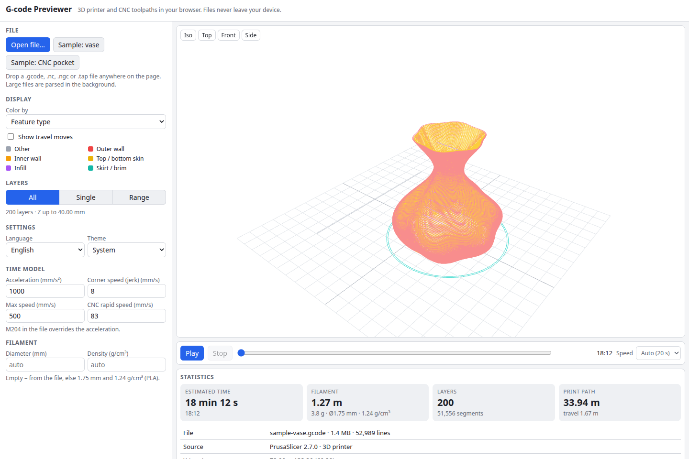

# G-code Previewer

Open a G-code file from your slicer or CAM and see the toolpath in 3D: colored by feature type, speed, layer or tool, filtered by layer, and played back with a moving tool head. It handles 3D printer files (Cura, PrusaSlicer, OrcaSlicer, Simplify3D) and CNC files (`.nc`, `.ngc`, `.tap`), parses 50+ MB files in a Web Worker with a progress bar, and estimates print time, filament and bounding box. Everything runs in your browser; files never leave your device.

**Try it: [hermes98761234.github.io/gcode-previewer](https://hermes98761234.github.io/gcode-previewer/)**

[](https://github.com/hermes98761234/gcode-previewer/actions/workflows/deploy.yml)



## Features

- **Open or drag in** `.gcode`, `.nc`, `.ngc`, `.tap` (any text file). Large files are stream-parsed in a Web Worker with live progress and a cancel button.
- **Real G-code semantics:** G0/G1 moves, G2/G3 arcs (I/J/K and R forms, planes G17/G18/G19, helical moves, full circles), G20/G21 units, G90/G91 and M82/M83 modes, G92 offsets, G28, G4 dwell, firmware retract (G10/G11, M207/M208), tool changes.
- **Slicer detection** (Cura, PrusaSlicer, OrcaSlicer, Simplify3D) and feature types read from comments: outer/inner walls, skin, infill, support, skirt/brim, bridges, gap fill, ironing, prime tower. Layers come from the slicer's own markers, or from Z changes for other files and CNC jobs.
- **3D view** (Three.js) with batched line segments: color by feature, speed, layer or tool, a travel-moves toggle, and top / iso / front / side camera presets.
- **Layer filter:** all layers, a single layer, or a range.
- **Simulation:** play, pause and scrub through the shown layers with a tool head marker and adjustable speed.
- **Statistics:** estimated time from an acceleration-limited trapezoid model with look-ahead, the slicer's own estimate when the file has one, filament length and weight, bounding box, layer count, and time per feature.
- **Built-in samples** generated in code: a small twisted vase and a CNC pocket with a helical bore and an R-arc profile.
- English and Ukrainian, light, dark or system theme, settings remembered in the browser, works on phones.

## How it works

The parser (`src/lib/parser.ts`) reads text in chunks, so memory stays bounded and the page never freezes. It tracks the modal machine state line by line and flattens every move, including arcs (`src/lib/arc.ts`, 0.02 mm chord tolerance), into segments stored in typed arrays: positions, feed, acceleration, extrusion, feature, tool and layer. Sorting by layer makes layer ranges a pair of indexes.

The estimator (`src/lib/estimator.ts`) computes a junction speed at every corner with the classic jerk rule, runs a backward and a forward pass so each move's entry and exit speeds are reachable under its acceleration (`M204` in the file wins over the setting), then times each move as a trapezoid, or a triangle when it is too short to reach cruise speed. Filament weight comes from the length, diameter and density.

The viewer shares one position buffer between a "print" line batch and a "travel" line batch, selecting what to draw with index buffers and draw ranges, so layer filtering and playback cost no geometry rebuilds. Three.js is split into a lazy chunk.

The time estimate is a model, not a firmware simulation: it knows nothing about pressure advance, per-axis limits or planner buffer size, so expect a few percent to tens of percent of difference from the real machine. Lines are one pixel wide; there is no tube rendering yet.

## Quick start

You need [Node.js](https://nodejs.org/) 22.

```bash
git clone https://github.com/hermes98761234/gcode-previewer.git
cd gcode-previewer
npm install
npm run dev       # http://localhost:5173
npm test          # parser, arcs, estimator, colors and i18n tests
npm run build     # static site in dist/
```

## License

MIT
